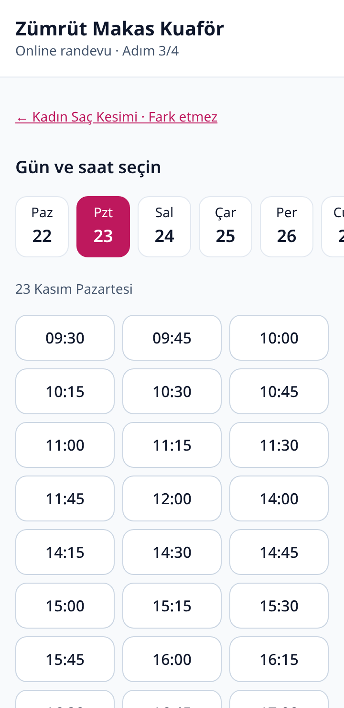
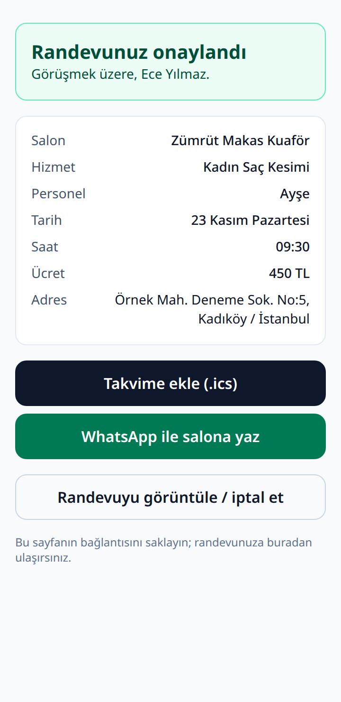
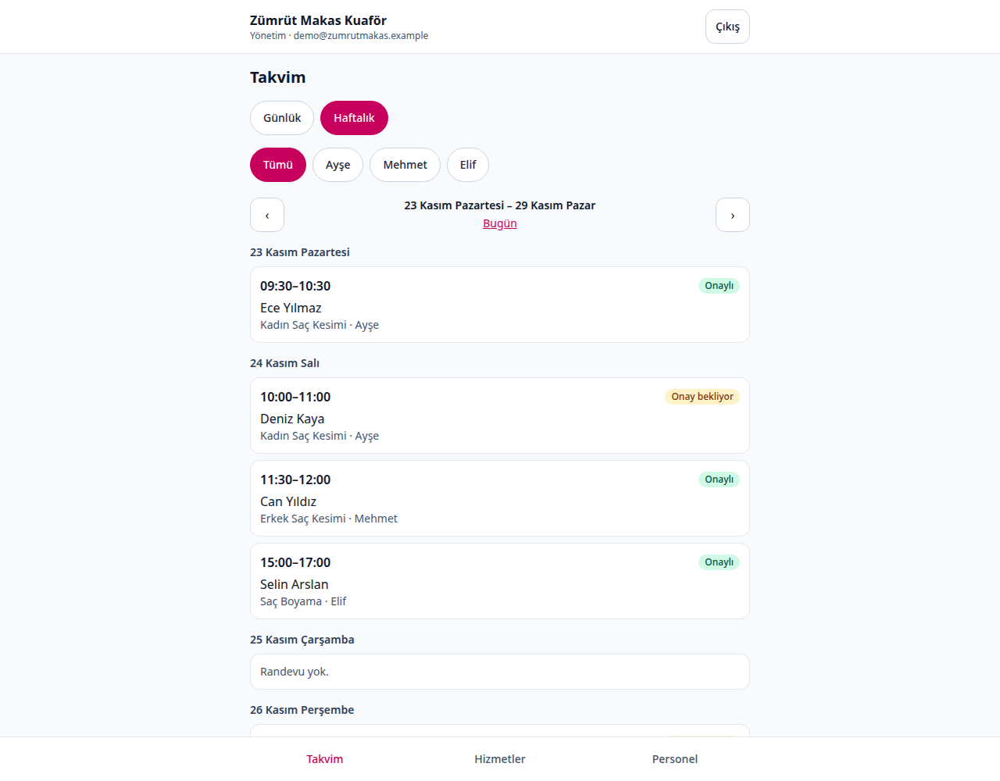

# Randevu Sistemi

Kuaför ve güzellik salonları için **üyeliksiz, mobil öncelikli online randevu** ve salon yönetim paneli. Müşteri hesap açmadan 4 adımda randevu alır; salon sahibi takvimi, hizmetleri ve personeli panelden yönetir. Sektör şablonları (klinik, diyetisyen, halı saha) için config tabanlı altyapı hazırdır.

**Canlı demo:** [fc-randevu-sistemi.vercel.app/demo-kuafor](https://fc-randevu-sistemi.vercel.app/demo-kuafor) (yönetim paneli: `/admin`)

| Randevu akışı (360px)                             | Onay sayfası (360px)              | Admin takvimi                                 |
| ------------------------------------------------- | --------------------------------- | --------------------------------------------- |
|  |  |  |

## Özellikler

- Hizmet, personel ("fark etmez" dahil), gün ve saat seçimi; geçmiş, dolu ve izinli saatler otomatik elenir
- Kayıt gerektirmez: ad + telefon, KVKK aydınlatma onayı, honeypot ve IP hız sınırı
- Onay sonrası `.ics` takvim dosyası, WhatsApp bağlantısı ve token'lı "görüntüle / iptal et" sayfası (iptal penceresi kuralıyla)
- Yönetim paneli: günlük / haftalık takvim, onay bekleyen randevular, onaylama ve iptal, hizmet ve personel yönetimi
- Hizmet bazlı süre ve tampon (buffer) süresi, personel bazlı çalışma saatleri ve izinler
- Sektör şablonları: terimler, slot adımı, onay gereksinimi, iptal penceresi tek config dosyasında
- Türkçe arayüz, 360px mobilde test edilir

## Mimari öne çıkanlar

- **Çift rezervasyon veritabanı seviyesinde engellenir.** `appointments` tablosunda `EXCLUDE USING gist (resource_id WITH =, period WITH &&) WHERE (status <> 'cancelled')` kısıtı var (`btree_gist`). Uygulama kodu yarışa güvenmez: tek INSERT, ihlalde `23P01` yakalanıp 409 "Bu saat az önce doldu" döner.
- **Zaman:** anlar `timestamptz` / `tstzrange` (UTC), çalışma saatleri yerel `time`; saat dilimi dönüşümü `@date-fns/tz` ile. Gece yarısını aşan ve tampon süreli randevular için testler var.
- **Slot hesaplama saf bir fonksiyondur** (çalışma aralıkları − izinler − dolu randevular), birim testlerle kapsanır.
- **Kimlik:** e-posta + Argon2id, veritabanında oturum tablosu (çerezde ham token, tabloda SHA-256 özeti), olmayan kullanıcıda da sabit maliyetli doğrulama (zamanlama farkı yok).
- **Hız sınırı Postgres'te** (tek `INSERT ... ON CONFLICT DO UPDATE` ile atomik sayaç); serverless örnekleri arasında paylaşılır.
- **Kiracı izolasyonu:** her tabloda `business_id`, her admin sorgusu oturumdaki işletmeye göre filtrelenir; izolasyon entegrasyon testiyle doğrulanır.
- **Barındırma:** Vercel (Frankfurt, Node) + Neon Postgres. Build sırasında migration otomatik ve idempotent çalışır; demo verisi her gece korumalı bir uç noktayla sıfırlanır.

### Testler

Gerçek Postgres üzerinde çalışan entegrasyon testleri (çakışma kısıtı, paralel rezervasyon, izolasyon, hız sınırı), birim testler ve 360px Playwright uçtan uca testleri. Yeni davranış ve hata düzeltmelerinde test önce çalıştırılıp başarısız görülür, sonra düzeltme yazılır.

## Yerel kurulum

Gereksinimler: Node.js 22.17+ (24 önerilir), Docker.

```bash
npm i
cp .env.example .env
npm run db:start      # Postgres 17 (docker, port 5433)
npm run db:migrate
npm run db:seed       # demo salonu + yönetici + 5 örnek randevu
npm run dev
```

Demo salonu: `http://localhost:5173/demo-kuafor` · yönetim: `/admin`

| Komut                            | Açıklama                                      |
| -------------------------------- | --------------------------------------------- |
| `npm test`                       | birim + entegrasyon (önce `npm run db:start`) |
| `npm run test:e2e`               | 360px uçtan uca (build + preview başlatır)    |
| `npm run check` / `npm run lint` | tip denetimi / prettier + eslint              |
| `npm run db:generate`            | şema değişikliğinden migration üretir         |

## Demo giriş bilgileri

Yalnız demo içindir, kurgusal veridir:

- E-posta: `demo@zumrutmakas.example`
- Şifre: `demo-1234`

Canlı demo her gece 03:00'te (İstanbul) başlangıç verisine döner.

## Yayına alma

Vercel + Neon adımları: [docs/DEPLOY.md](docs/DEPLOY.md). Mimari kararlar: [docs/ARCHITECTURE.md](docs/ARCHITECTURE.md).

---

## English summary

A sign-up-free, mobile-first online appointment system for hair and beauty salons, with an admin panel (SvelteKit 5 + TypeScript, Drizzle ORM, Postgres, Tailwind v4). Double bookings are prevented at the database level with a Postgres `EXCLUDE USING gist` constraint on `(resource_id, tstzrange)`, so concurrency never depends on application logic. It also includes Argon2id admin auth with DB-backed sessions, Postgres-backed atomic rate limiting, `.ics`/WhatsApp confirmations with token-based self-service cancellation, per-tenant isolation, and integration tests against a real Postgres plus 360px Playwright e2e tests. Deploys to Vercel (Frankfurt) with Neon Postgres; migrations run automatically at build time and demo data resets nightly via a secret-protected endpoint called from GitHub Actions.
